# Roonjha Print Share (رونجھا پرنٹ شیئر)
### Offline QR-Based Document Sharing PWA for Printing Shops
**Software by Roonjha Developers : 0315291486**

---

## 1. Overview & Shop Workflow

**Roonjha Print Share** is a high-performance, mobile-first Progressive Web App (PWA) and local desktop receiving server designed specifically for printing and photostat shops in Pakistan. It allows walk-in customers to transfer documents (PDFs, Word documents, Excel sheets, PowerPoint presentations, national ID card scans, and photos) directly from their smartphones (Android or iPhone) to the shopkeeper's Windows PC **without requiring internet or mobile data**.

### Daily Operational Workflow:
1. **Morning Start**: The shopkeeper double-clicks `start-server.bat` on the Windows PC (or opens the deployed Vercel URL).
2. **Local Network Ready**: The PC connects to the shop Wi-Fi / customer hotspot, or enables Windows built-in Mobile Hotspot.
3. **Customer Arrival**: Customer arrives with documents on their smartphone.
4. **Counter / Wall Scan**: The customer connects to the counter Wi-Fi / Hotspot and scans the laminated Wall QR poster displayed on the shop wall.
5. **Direct Transfer**: The customer upload PWA opens in Chrome or Safari. The customer selects multiple files and taps **"Send to Printer"**.
6. **Instant Notification**: The PC dashboard immediately chimes with an audio alert and displays the incoming job with a 4-digit token (e.g. `RPS-4821`).
7. **Review & Print**: The shopkeeper previews the PDF/photos or opens Office docs, adjusts copies/color/fit-to-page, and clicks **Print**!

---

## 2. Shop Wall QR Poster Printing (A4 / A3)

Shopkeepers can generate and print high-resolution posters to stick on the shop entrance or counter wall:

1. Open the PC Dashboard and click the gold **"Print Wall QR Poster"** button in the header.
2. Customize the details in the interactive drawer:
   - **Shop Name**: e.g., `Roonjha Print & Photostat Center`
   - **Shop Wi-Fi Name (SSID)**: e.g., `Shop-WiFi` or `Roonjha-Hotspot`
   - **Wi-Fi Password**: e.g., `No Password (Connect Directly)`
   - **Helpline / WhatsApp**: `0315291486`
   - **Shop Services**: e.g., `Photostat • Color Print • Lamination • Urgent Photos`
3. Click **"Print Wall Poster"**:
   - The browser print preview automatically applies dedicated CSS `@media print` rules, formatting the poster cleanly for standard **A4 or A3 paper**.
   - Features a giant high-contrast QR code for instant scanning from 1-2 meters away.
   - Includes bilingual **Urdu & English** step-by-step guidance.
4. Laminate and affix to your shop wall or counter acrylic display!

---

## 3. PWA App Installation (Mobile-Driven & PC-Driven)

Roonjha Print Share is an installable Progressive Web App (PWA) on both mobile and desktop devices:

### A. PC Installation (Windows / Desktop Chrome & Edge):
1. Open the Dashboard in Chrome or Edge.
2. Click the **"Install on PC"** button in the top navigation bar.
3. Confirm **"Install"** in the browser prompt.
4. The application installs as a native Windows desktop app in its own standalone window with a desktop shortcut!

### B. Mobile Installation (Android & iPhone):
- **Android**: Tap the **"Add to Home Screen"** banner on the upload page (`/upload`) to add the app icon directly to your phone.
- **iPhone / iPad Safari**: Tap the **"Install App"** button to view the step-by-step iOS guide:
  1. Tap the Safari **Share** icon (`[⎋]`) at the bottom.
  2. Tap **"Add to Home Screen"** (`[⊞]`).
  3. Tap **"Add"** in the top right.
- Customers now have a dedicated app icon on their phone home screen for 1-tap document sending every time they visit the shop!

---

## 4. Deploying to Vercel

Roonjha Print Share is fully architected for zero-configuration deployment to **Vercel**:

### Quick Deploy:
1. Push your repository to GitHub:
   ```bash
   git push origin main
   ```
2. Go to [https://vercel.com/new](https://vercel.com/new) and import `Offline-QR-Based-Document-Sharing-PWA-for-Printing-Shops`.
3. Set the Framework Preset to **Next.js** (detected automatically).
4. (Optional) Configure environment variables in the Vercel dashboard:
   - `SHOP_NAME`: `Roonjha Print & Photostat Center`
   - `SHOP_CONTACT`: `0315291486`
   - `OWNER_PIN`: `1234`
5. Click **Deploy**.

### How Cloud / Vercel Mode Works:
- **Automatic Domain Detection**: When accessed via `https://your-app.vercel.app`, the system automatically detects the cloud domain and generates QR codes pointing to `https://your-app.vercel.app/upload`.
- **Serverless Dual-Engine Storage**: Uses an embedded fallback store in `/tmp` when running in serverless environments where native SQLite binaries are not pre-installed.
- **Full Offline Fallback**: The exact same codebase also runs 100% offline on a local Windows PC without internet using `start-server.bat`.

---

## 5. Network Architecture & Topology Investigation

```mermaid
graph TD
    subgraph "Configuration A: Shared Phone Hotspot"
        PhoneHotspot["Shopkeeper Phone Hotspot<br/>(Mobile Data OFF)"]
        CustomerPhoneA["Customer Phone<br/>(192.168.43.45)"] -->|Wi-Fi| PhoneHotspot
        ShopPCA["Shop Windows PC<br/>(192.168.43.150)"] -->|Wi-Fi| PhoneHotspot
        CustomerPhoneA -->|Direct Local HTTP :3000| ShopPCA
    end

    subgraph "Configuration B: Dual Network Interfaces (PC Internet + Hotspot)"
        FiberRouter["Shop Fiber / DSL Broadband<br/>(Internet)"]
        HotspotPhone["Counter Phone Hotspot<br/>(Customer Wi-Fi)"]
        ShopPCB["Shop Windows PC<br/>Dual Network Adapters"]
        ShopPCB -->|NIC 1: Ethernet / Wi-Fi| FiberRouter
        ShopPCB -->|NIC 2: Wi-Fi Dongle| HotspotPhone
        CustomerPhoneB["Customer Phone"] -->|Wi-Fi| HotspotPhone
        CustomerPhoneB -->|Upload over NIC 2 :3000| ShopPCB
    end

    subgraph "Configuration C: Windows Mobile Hotspot / Dedicated Counter Router (Recommended)"
        ShopPCC["Shop Windows PC<br/>(Hosts Mobile Hotspot 192.168.137.1)"]
        CustomerPhoneC1["Customer Android"] -->|Direct Local Wi-Fi| ShopPCC
        CustomerPhoneC2["Customer iPhone"] -->|Direct Local Wi-Fi| ShopPCC
        ShopPCC -->|Built-in Printer Cable| ShopPrinter["Shop Counter Printer"]
    end
```



| Configuration | Description | Pros | Considerations |
| :--- | :--- | :--- | :--- |
| **Config A: Shared Phone Hotspot** | The shopkeeper creates a hotspot on an Android or iPhone with Mobile Data OFF. Both the PC and customer phones join this Wi-Fi. | Zero extra hardware; uses any phone. | Check that AP isolation is not forced by phone vendor. |
| **Config B: Dual Network Adapters** | The PC has 2 network interfaces (e.g., Ethernet connected to Shop broadband, and Wi-Fi adapter joined to customer hotspot). | Shop PC retains 100% internet access while receiving offline customer uploads. | Server binds to `0.0.0.0:3000` (INADDR_ANY) and displays the hotspot adapter IP on the QR code. |
| **Config C: Windows Mobile Hotspot or Offline Router (Recommended)** | Option 1: Turn on Windows 10/11 built-in "Mobile Hotspot" (`192.168.137.1`). Option 2: Place an inexpensive Rs. 2,000 TP-Link/Tenda router at counter (WAN unplugged). | **Zero battery drain on phone**, highest speed (Wi-Fi 5/6), deterministic static IP, rock-solid stability all day. | Most recommended for busy printing shops. |

---

## 6. Windows Installation & Deployment

### Prerequisites:
- Windows 10 or 11 (64-bit)
- Node.js v20.x or v22.x installed ([https://nodejs.org](https://nodejs.org))

### Quick Setup:
1. Open PowerShell or Command Prompt in the project folder:
   ```powershell
   cd "D:\QR Based Docs Sharing"
   npm install --legacy-peer-deps
   ```
2. Configure Windows Defender Firewall (Run once as Administrator):
   - Right-click `setup-firewall.bat` and select **"Run as administrator"**.
3. Start the Server:
   - Double-click `start-server.bat`.
   - The server starts on port 3000, inspects network adapters, and opens the dashboard in your default browser.
4. Stop the Server:
   - Double-click `stop-server.bat`.

---

## 7. Security & Privacy for Customer Documents

1. **Zero Cloud Requirement**: Files are transmitted directly across the local Wi-Fi router/hotspot into the PC's local storage (`./uploads/jobs/<jobId>/`).
2. **Access Isolation**: Customers can only view their own upload confirmation with their unique 4-digit token. They cannot view or download other customers' files.
3. **Owner Security PIN**: Access to settings, security configuration, and bulk deletion is protected by an Owner PIN (default `1234`).
4. **Collision-Resistant Storage**: Files are saved with timestamps and cryptographic random hex prefixes while preserving original display filenames in SQLite.
5. **Strict File Validation**:
   - Rejects executable files (`.exe`, `.bat`, `.cmd`, `.vbs`, `.ps1`, `.scr`, `.sh`, etc.).
   - Validates magic numbers (file signatures) for PDFs, JPEGs, PNGs, and Office documents.
   - Blocks path traversal (`../`) and illegal Windows filename characters.
6. **Automatic Cleanup**: Old jobs are automatically purged after the configurable retention period (default 24 hours).

---

## 8. Automated Tests

Run the test suite with:
```powershell
npm test
```

Expected output:
```
✔ Network discovery module identifies interfaces
✔ File validator correctly identifies valid and dangerous files
✔ Filename sanitization blocks directory traversal characters
✔ SQLite Database initializes schema, creates and updates jobs
All tests passing!
```

---

## 9. Developer & Support

- **Software**: Roonjha Print Share (Local Offline Printing PWA)
- **Developer Team**: Roonjha Developers
- **Direct Phone / WhatsApp**: `0315291486`
- **GitHub Repository**: [https://github.com/nasrqasim/Offline-QR-Based-Document-Sharing-PWA-for-Printing-Shops](https://github.com/nasrqasim/Offline-QR-Based-Document-Sharing-PWA-for-Printing-Shops)
