# Roonjha Print Share (رونجھا پرنٹ شیئر)
### Offline QR-Based Document Sharing PWA for Printing Shops
**Software by Roonjha Developers : 0315291486**

---

## 1. Overview & Shop Workflow

**Roonjha Print Share** is a high-performance, mobile-first Progressive Web App (PWA) and local desktop receiving server designed specifically for printing and photostat shops in Pakistan. It allows walk-in customers to transfer documents (PDFs, Word documents, Excel sheets, PowerPoint presentations, national ID card scans, and photos) directly from their smartphones (Android or iPhone) to the shopkeeper's Windows PC **without requiring internet or mobile data**.

### Daily Operational Workflow:
1. **Morning Start**: The shopkeeper double-clicks `start-server.bat` on the Windows PC.
2. **Local Network Ready**: The PC connects to the shop Wi-Fi / customer hotspot, or enables Windows built-in Mobile Hotspot.
3. **Customer Arrival**: Customer arrives with documents on their smartphone.
4. **Counter Scan**: The customer connects to the counter Wi-Fi / Hotspot and scans the laminated QR code poster displayed at the counter.
5. **Direct Transfer**: The customer upload PWA opens in Chrome or Safari. The customer selects multiple files and taps **"Send to Printer"**.
6. **Instant Notification**: The PC dashboard immediately chimes with an audio alert and displays the incoming job with a 4-digit token (e.g. `RPS-4821`).
7. **Review & Print**: The shopkeeper previews the PDF/photos or opens Office docs, adjusts copies/color/fit-to-page, and clicks **Print**!

---

## 2. Network Architecture & Topology Investigation

Connecting customers to a phone hotspot does **not** automatically make an unrelated PC reachable. To guarantee reliable communication across all shop setups, Roonjha Print Share provides explicit, verified support for 3 network topologies:



### Analysis of the Configurations:

```mermaid
graph TD
    subgraph "Configuration A: Shared Phone Hotspot"
        PhoneHotspot["Shopkeeper Phone Hotspot<br/>(Mobile Data OFF)"]
        CustomerPhoneA["Customer Phone<br/>(192.168.43.45)"] -->|Wi-Fi| PhoneHotspot
        ShopPCA["Shop Windows PC<br/>(192.168.43.150)"] -->|Wi-Fi| PhoneHotspot
        CustomerPhoneA -->|Direct Local HTTP :3000| ShopPCA
    end

    subgraph "Configuration B: Dual Network Interfaces (PC Internet + Hotspot)"
        FiberRouter["Shop Fiber / DSL Broadband<br/>(Internet)"]
        HotspotPhone["Counter Phone Hotspot<br/>(Customer Wi-Fi)"]
        ShopPCB["Shop Windows PC<br/>Dual Network Adapters"]
        ShopPCB -->|NIC 1: Ethernet / Wi-Fi| FiberRouter
        ShopPCB -->|NIC 2: Wi-Fi Dongle| HotspotPhone
        CustomerPhoneB["Customer Phone"] -->|Wi-Fi| HotspotPhone
        CustomerPhoneB -->|Upload over NIC 2 :3000| ShopPCB
    end

    subgraph "Configuration C: Windows Mobile Hotspot / Dedicated Counter Router (Recommended)"
        ShopPCC["Shop Windows PC<br/>(Hosts Mobile Hotspot 192.168.137.1)"]
        CustomerPhoneC1["Customer Android"] -->|Direct Local Wi-Fi| ShopPCC
        CustomerPhoneC2["Customer iPhone"] -->|Direct Local Wi-Fi| ShopPCC
        ShopPCC -->|Built-in Printer Cable| ShopPrinter["Shop Counter Printer"]
    end
```

| Configuration | Description | Pros | Considerations |
| :--- | :--- | :--- | :--- |
| **Config A: Shared Phone Hotspot** | The shopkeeper creates a hotspot on an Android or iPhone with Mobile Data OFF. Both the PC and customer phones join this Wi-Fi. | Zero extra hardware; uses any phone. | Check that AP isolation is not forced by phone vendor. |
| **Config B: Dual Network Adapters** | The PC has 2 network interfaces (e.g., Ethernet connected to Shop PTCL/StormFiber internet, and Wi-Fi adapter joined to customer hotspot). | Shop PC retains 100% internet access while receiving offline customer uploads. | Server binds to `0.0.0.0:3000` (INADDR_ANY) and displays the hotspot adapter IP on the QR code. |
| **Config C: Windows Mobile Hotspot or Offline Router (Recommended)** | Option 1: Turn on Windows 10/11 built-in "Mobile Hotspot" (`192.168.137.1`). Option 2: Place an inexpensive Rs. 2,000 TP-Link/Tenda router at counter (WAN unplugged). | **Zero battery drain on phone**, highest speed (Wi-Fi 5/6), deterministic static IP, rock-solid stability all day. | Most recommended for busy printing shops. |

---

## 3. Technology Stack

- **Framework**: Next.js 14 App Router with React 18
- **Language**: TypeScript with strict type checking
- **Styling**: Tailwind CSS with custom navy & blue palette
- **Icons**: Lucide React
- **Local Database**: Embedded SQLite (`node:sqlite` in Node 22 / `better-sqlite3` compatible) with WAL journal mode
- **Real-Time Updates**: Server-Sent Events (SSE) with fallback polling
- **PWA Experience**: Web App Manifest (`manifest.json`) + Service Worker (`sw.js`)
- **Document Packaging**: Node Stream Archiver for ZIP creation
- **QR Engine**: `qrcode.react` with high error-correction level (Level H)

---

## 4. Security & Privacy for Customer Documents

Pakistani print shops frequently handle sensitive customer documents (CNIC copies, university degrees, domicile certificates, property records, bank statements, legal affidavits).

Roonjha Print Share protects customer privacy with the following measures:
1. **Zero Cloud Upload**: Files are transmitted directly across the local Wi-Fi router/hotspot into the PC's local storage (`./uploads/jobs/<jobId>/`). No third-party servers, Firebase, or external APIs are used.
2. **Access Isolation**: Customers can only view their own upload confirmation with their unique 4-digit token. They cannot view, list, or download any other customer's files.
3. **Owner Security PIN**: Access to settings, security configuration, and bulk deletion is protected by an Owner PIN (default `1234`).
4. **Collision-Resistant Storage**: Files are saved with timestamps and cryptographic random hex prefixes (e.g. `1793129592659_83486394_CNIC.pdf`) while preserving original display filenames in SQLite.
5. **Strict File Validation**:
   - Rejects executable files (`.exe`, `.bat`, `.cmd`, `.vbs`, `.ps1`, `.scr`, `.sh`, etc.).
   - Validates magic numbers (file signatures) for PDFs, JPEGs, PNGs, and Office documents.
   - Blocks path traversal (`../`) and illegal Windows filename characters.
6. **Automatic Cleanup**: Old jobs are automatically purged after the configurable retention period (default 24 hours).

---

## 5. Windows Installation & Deployment

### Prerequisites:
- Windows 10 or 11 (64-bit)
- Node.js v20.x or v22.x installed ([https://nodejs.org](https://nodejs.org))

### Quick Setup:
1. Open PowerShell or Command Prompt in the project folder:
   ```powershell
   cd "D:\QR Based Docs Sharing"
   npm install --legacy-peer-deps
   ```
2. Configure Windows Defender Firewall (Run once as Administrator):
   - Right-click `setup-firewall.bat` and select **"Run as administrator"**.
   - Or run in PowerShell:
     ```powershell
     netsh advfirewall firewall add rule name="Roonjha Print Share" dir=in action=allow protocol=TCP localport=3000 profile=private
     ```
3. Start the Server:
   - Double-click `start-server.bat`.
   - The server starts on port 3000, inspects network adapters, and opens the dashboard in your default browser.
4. Stop the Server:
   - Double-click `stop-server.bat`.

---

## 6. Daily Counter Operations & Printing Guide

1. **Print the Counter QR Poster**:
   - On the Owner Dashboard, click the blue **"Counter QR Poster"** button.
   - Click **"Print Poster"** to print out an attractive A4 sign with shop branding, Urdu & English instructions, and the QR code.
   - Laminate the poster and stick it to your counter.
2. **When Customers Arrive**:
   - Tell customer: *"Connect your phone to our shop Wi-Fi / Hotspot, then scan this QR code."*
   - Customer opens phone camera, scans QR code, and taps the link.
   - Customer picks their files, adds optional instructions (e.g., *"2 copies color"*), and taps **"Send to Printer"**.
3. **Receiving & Printing**:
   - Your PC will chime with a two-tone alert.
   - Customer says: *"My token is RPS-1676"*.
   - Find `RPS-1676` in your dashboard.
   - Click **Preview** to inspect the document.
   - Click **Print** or **Print All** to trigger the print dialog with your desired paper size (A4, Legal, Letter) and color profile.

---

## 7. Troubleshooting & FAQ

#### Q: Customer's phone says "Site cannot be reached" or times out after scanning QR code?
- **Cause 1**: The customer is still using mobile data (4G/5G).
  * *Fix*: Have the customer turn **OFF** Mobile Data in their phone pull-down menu so all requests travel over the shop Wi-Fi.
- **Cause 2**: Customer joined a different Wi-Fi than the PC.
  * *Fix*: Ensure both phone and PC are connected to the exact same Wi-Fi SSID.
- **Cause 3**: Windows Defender Firewall is blocking inbound port 3000.
  * *Fix*: Run `setup-firewall.bat` as Administrator.
- **Cause 4**: Mobile Hotspot has "Client Isolation" turned on.
  * *Fix*: On Android/iPhone, check hotspot settings and disable "AP Isolation" or "Isolate Clients".

#### Q: How to keep PC connected to shop broadband internet while receiving customer documents?
- Use **Configuration B** (Dual Network Adapters) or **Configuration C** (Windows Mobile Hotspot).
- Connect the PC to your shop broadband router for internet, and plug in a USB Wi-Fi adapter or turn on Windows Mobile Hotspot for customers.

---

## 8. Automated Tests

The application includes unit and integration tests verifying network detection, SQLite storage, file validation, path traversal prevention, and magic bytes verification.

To run tests:
```powershell
npm test
```

Expected output:
```
✔ Network discovery module identifies interfaces
✔ File validator correctly identifies valid and dangerous files
✔ Filename sanitization blocks directory traversal characters
✔ SQLite Database initializes schema, creates and updates jobs
All tests passing!
```

---

## 9. Developer & Support

- **Software**: Roonjha Print Share (Local Offline Printing PWA)
- **Developer Team**: Roonjha Developers
- **Direct Phone / WhatsApp**: `0315291486`
- **License**: Proprietary for Shop Operations
